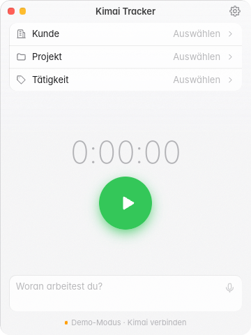
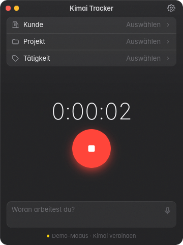

# Kimai Tracker

A minimalist, open-source desktop time tracker for [Kimai](https://www.kimai.org) –
built with Go, [Wails v3](https://v3.wails.io), Svelte, TypeScript and Tailwind CSS.

> **Status:** early development (step 1 of 6 – window shell & design). The Kimai
> connection, tray, hotkey and voice input are being added step by step, see
> [Roadmap](#roadmap).

| Light | Dark |
| ----- | ---- |
|  |  |

<sub>Preliminary screenshots (step 1, demo mode) – will be replaced once the Kimai flow is in place.</sub>

## Features

- Compact, frameless window (360 × 480) with rounded corners, translucent surface and soft shadow
- Automatic light/dark mode following the system
- Customer → project → activity selection with search and recently used entries *(step 3)*
- Big start/stop button with live elapsed time; picks up a timer already running in Kimai *(step 3)*
- Runs in the background: tray icon with status, global hotkey, notifications *(step 4)*
- Voice input for the description via local whisper.cpp or an OpenAI-compatible API *(step 5)*
- API token stored in the system keyring, never in plain text *(step 2)*

## Installation

Prebuilt `.deb` and AppImage packages will be published on the
[Releases](https://github.com/klein-it-solutions/kimai-desktop-app/releases) page
once packaging (step 6) is done. Until then, build from source.

### Build from source (Ubuntu)

Requirements:

- Go ≥ 1.25
- Node.js ≥ 20 and npm
- GTK 4 and WebKitGTK 6.0 development files (Ubuntu 24.04 or newer)

```bash
sudo apt install build-essential pkg-config libgtk-4-dev libwebkitgtk-6.0-dev

git clone https://github.com/klein-it-solutions/kimai-desktop-app.git
cd kimai-desktop-app
make deps      # installs the wails3 CLI and frontend packages
make build     # → ./bin/kimai-tracker
./bin/kimai-tracker
```

The Makefile finds the `wails3` CLI in `$(go env GOPATH)/bin` automatically. To call
`wails3` directly, add that directory to your `PATH`.

**Ubuntu 22.04:** GTK 4/WebKitGTK 6.0 are not available there. Use the GTK 3 stack instead:

```bash
sudo apt install build-essential pkg-config libgtk-3-dev libwebkit2gtk-4.1-dev
make build GTK3=1
```

### Development

| Command      | Description                                       |
| ------------ | ------------------------------------------------- |
| `make dev`   | Hot-reload development mode (Go + Vite)           |
| `make build` | Production binary in `./bin`                      |
| `make test`  | Go unit tests and frontend type check             |
| `make lint`  | `go vet` and `gofmt` check                        |
| `make help`  | All targets                                       |

## Kimai API token

Kimai Tracker talks to the Kimai 2.x REST API and authenticates with a personal API token.

1. Log in to your Kimai instance.
2. Open your profile (avatar, top right) → **API Access** / **API-Zugang**.
3. Create a new token, give it a name such as "Kimai Tracker" and copy it –
   it is shown only once.
4. In Kimai Tracker open **Settings**, enter your Kimai URL
   (e.g. `https://kimai.example.com`) and paste the token.
5. Click **Test connection**.

The token is stored in the system keyring (GNOME Keyring / KWallet via the Secret Service API,
macOS Keychain, Windows Credential Manager) – not in the configuration file.
Non-secret settings live in `~/.config/kimai-tracker/config.json`.

Your Kimai user needs permission to use the API and to create/edit their own timesheets.

## Linux notes

- **Transparency & blur:** The window background is semi-transparent when a compositor
  is running (default on GNOME, KDE and most Wayland sessions). Linux has no common API
  to blur what is *behind* a window, so the frosted look is approximated with a tinted
  surface and subtle grain. Without a compositor (rare on X11) the transparent margin
  appears dark.
- **Wayland vs. X11:** Both are supported. Wayland restrictions for the global hotkey
  are documented together with step 4.

## Project structure

```
.
├── main.go                 # Wails application & window setup
├── internal/
│   ├── app/                # Services exposed to the frontend
│   ├── config/             # Configuration & keyring        (step 2)
│   ├── kimai/              # Kimai REST client with tests   (step 2)
│   └── voice/              # Recording & transcription      (step 5)
├── frontend/               # Svelte + TypeScript + Tailwind UI
│   ├── bindings/           # Generated TypeScript bindings for Go services
│   └── src/
├── build/                  # Wails build assets (icons, .desktop, nfpm, AppImage)
├── docs/                   # Architecture notes, screenshots
├── Makefile
└── Taskfile.yml            # Used internally by the wails3 CLI
```

See [docs/architecture.md](docs/architecture.md) for technical decisions.

## Roadmap

1. ✅ Wails shell with frameless, styled window
2. ⏳ Settings + Kimai client including connection test
3. ⏳ Customer/project/activity flow and start/stop
4. ⏳ Tray, global hotkey, background operation
5. ⏳ Voice input
6. ⏳ Packaging (.deb, AppImage) and CI; later macOS/Windows

## License

[MIT](LICENSE)
